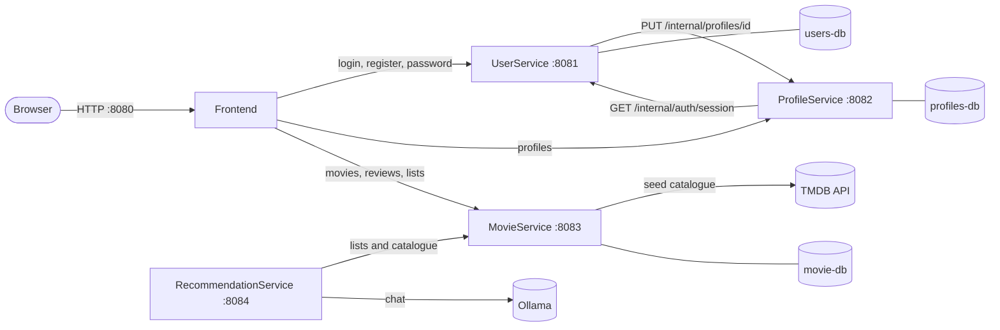
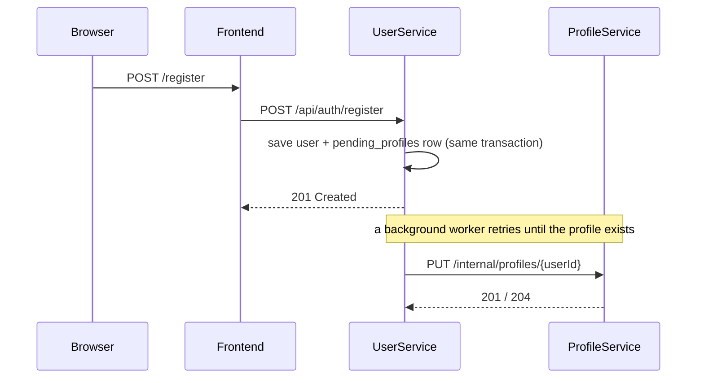
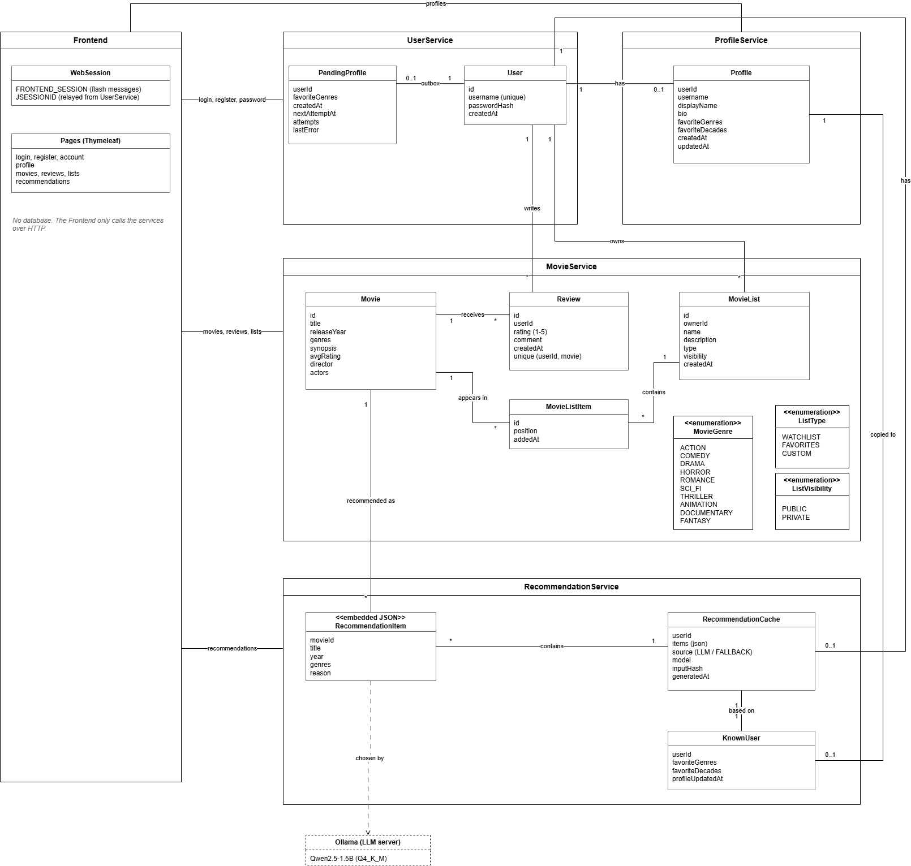

# Movie Rec Hub

**Movie Rec Hub** is a movie platform built as a small set of Spring Boot microservices. Users can create an account, browse a movie catalogue, write reviews, organise movies into lists, build a public profile and (soon) ask an AI model for personalised recommendations.

Everything runs with a single `docker compose up --build`. Each service owns its own database, talks to the others over HTTP and can also be started on its own for development.

---

## Authors

| Name |
|------|
| Gonçalo Torcato |
| Sara Nascimento |
| Sofia Rodrigues |

> Group **g34** · repository: `gitlab.rnl.tecnico.ulisboa.pt/psia/groups26/g34`

---

## Context

The platform is split by **bounded context**. Each context is its own service, with its own database and its own release cycle:

| Context | Service | What it owns |
|---|---|---|
| Identity | [UserService](UserService/README.md) | Accounts, passwords, login sessions |
| Social | [ProfileService](ProfileService/README.md) | Public profiles, favourite genres and decades |
| Catalogue | [MovieService](MovieService/README.md) | Movies, reviews, movie lists |
| Recommendations | [RecommendationService](RecommendationService/README.md) | AI-assisted suggestions (Ollama) |
| Presentation | [Frontend](Frontend/README.md) | Server-rendered web UI (Thymeleaf) |

Core features:
- Registration, login and password change
- Browsing and searching movies (title, director, actor, genre, year)
- Reviews with a 1–5 rating (one per user per movie) that update the movie's average rating
- Personal movie lists (Watchlist, Favorites and custom lists, public or private)
- Public profiles with display name, bio, favourite genres and decades
- Recommendations based on the user's lists, powered by a local LLM

---

## Architecture



### Services at a glance

| Service | Container | Port | Database | Health | Status |
|---|---|---|---|---|---|
| Frontend | `frontend` | `8080` | – | `/actuator/health` | ✅ integrated |
| UserService | `user-service` | `8081` | `users-db` (`5433`) | `/actuator/health` | ✅ integrated |
| ProfileService | `profile-service` | `8082` | `profiles-db` (`5434`) | `/actuator/health` | ✅ integrated |
| MovieService | `movie-service` | `8083` | `movie-db` (`5435`) | `/actuator/health` | ✅ integrated |
| RecommendationService | `recommendation-service` | `8084` | – (stateless) | `/actuator/health` | 🚧 on `feature/RecommendationService`, not wired into compose yet |

> **Note:** the **Frontend** is the only part meant to be opened in a browser. The backend services also publish a port on `127.0.0.1`, but only so you can test them with `curl`/Postman and look at their databases.

### How the pieces cooperate

**Registration** (eventual consistency, no distributed transaction):



If ProfileService is down when someone registers, nothing is lost: the job stays in `pending_profiles` and is retried every 30 seconds. For a few seconds after registration `GET /api/profiles/me` can answer `PROFILE_NOT_READY`.

**Login and sessions**
1. The Frontend sends the credentials to UserService, which creates the login session and answers with a `JSESSIONID` cookie.
2. The Frontend relays that cookie to the browser untouched.
3. On every request the Frontend (and ProfileService) ask UserService `GET /internal/auth/session` to find out who the cookie belongs to.
4. The Frontend has its own session for flash messages, under a different cookie name (`FRONTEND_SESSION`), so it never overwrites the login cookie.

**Movie actions** (reviews, lists) – the Frontend resolves the user from the session and calls MovieService with the header `X-User-Id`.

### Design decisions

| Decision | Why |
|---|---|
| One database per service, no cross-service foreign keys | Each service can evolve its schema alone. User ids are just numbers in the other databases. |
| Plain REST/HTTP between services | Simple to run, debug and demo. No broker to operate. |
| Transactional outbox (`pending_profiles`) for profile creation | Registration never fails because ProfileService is unavailable. |
| Session cookie owned by UserService | One place to log in and log out; other services only verify it. |
| Flyway migrations in User/Profile services, `validate` mode | The schema is versioned and Hibernate never changes it. |
| Same Dockerfile layout everywhere | Multi-stage build, JRE image, non-root user, built-in healthcheck. |

---

## Domain Model



> The editable source is `DomainModel.drawio` (open it with [diagrams.net](https://app.diagrams.net/)).

---

## Repository Layout

```plaintext
g34/
├── docker-compose.yml          --> Whole stack (databases, services, frontend)
├── .env.example                --> Variables for docker-compose (copy to .env)
├── DomainModel.drawio / .png   --> Domain model
├── format-code.sh              --> google-java-format hook (used by pre-commit)
├── .pre-commit-config.yaml     --> Pre-commit hooks
│
├── UserService/                --> Accounts, passwords, sessions
│   ├── compose.yaml            --> users-db only (reused by the root compose)
│   └── src/main/resources/db/migration/   --> Flyway migrations
├── ProfileService/             --> Public profiles
│   ├── compose.yaml            --> profiles-db only
│   └── src/main/resources/db/migration/
├── MovieService/               --> Catalogue, reviews, lists
│   └── compose.yaml            --> movie-db only
├── RecommendationService/      --> AI recommendations (Ollama)
└── Frontend/                   --> Thymeleaf web application
```

Every service folder has its own `README.md` with endpoints, configuration and database details.

---

## Getting Started

### Requirements

| Tool | Version | Needed for |
|---|---|---|
| Docker + Docker Compose v2 | recent | Running the whole stack |
| Java (JDK) | 17+ | Running a service outside Docker |
| Maven | 3.9+ | Running a service outside Docker |
| TMDB API key | – | Seeding the movie catalogue ([get one here](https://www.themoviedb.org/settings/api)) |

### 1. Configure

```bash
cp .env.example .env
```

Open `.env` and set at least your TMDB key:

```env
TMDB_API_KEY=your_key_here
```

All the other variables are optional host ports (see [Ports and Variables](#ports-and-variables)).

> **Note:** `.env` is git-ignored. Never commit your API key.

### 2. Run

```bash
docker compose up --build
```

The first build downloads dependencies and can take a few minutes. Wait until the services report `healthy` (UserService can take about a minute to boot):

```bash
docker compose ps
```

### 3. Use it

| What | Where |
|---|---|
| **Web application** | http://localhost:8080 |
| UserService (REST) | http://localhost:8081 |
| ProfileService (REST) | http://localhost:8082 |
| MovieService (REST) | http://localhost:8083 |

1. Open http://localhost:8080 and click **Register**.
2. Pick a username (3–30 characters: lowercase letters, digits, `_`), a **password with at least 12 characters** and at least one favourite genre.
3. Sign in, browse the movies, write a review, create a list, edit your profile.

> **Note:** the catalogue is filled automatically from TMDB the first time MovieService starts with an **empty** movie table (the 40 or so top-rated movies). Without a valid `TMDB_API_KEY` the catalogue stays empty and the service logs a warning.

### Stopping

```bash
docker compose down          # stop, keep the data
docker compose down -v       # stop and DELETE all databases
```

---

## Databases

There are three PostgreSQL 16 containers, one per service. They are published on `127.0.0.1` only, so you can connect with [DBeaver](https://dbeaver.io/), `psql` or any other client.

| Field | users-db | profiles-db | movie-db |
|---|---|---|---|
| Host | `localhost` | `localhost` | `localhost` |
| Port | `5433` | `5434` | `5435` |
| Database | `movie_rec_hub_users` | `movie_rec_hub_profiles` | `movie_rec_hub_movies` |
| User | `user_service` | `profile_service` | `movie_service` |
| Password | _(empty)_ | _(empty)_ | _(empty)_ |
| Owner service | UserService | ProfileService | MovieService |

> **Note:** the development databases use PostgreSQL's `trust` authentication, so **no password is needed** – leave the password field empty. They are only reachable from your own machine.

### Connecting with DBeaver

1. **Database → New Database Connection → PostgreSQL**
2. Fill in Host, Port, Database and Username from the table above. Leave **Password** empty.
3. Click **Test Connection** (DBeaver downloads the driver the first time) and then **Finish**.
4. Browse to `<connection> → Databases → <database> → Schemas → public → Tables`.

> **Note:** the stack must be running (at least the database container) for the connection to work. Starting only the databases is enough: `docker compose up -d users-db profiles-db movie-db`.

### Connecting with psql (no client installed)

```bash
docker compose exec users-db    psql -U user_service    -d movie_rec_hub_users
docker compose exec profiles-db psql -U profile_service -d movie_rec_hub_profiles
docker compose exec movie-db    psql -U movie_service   -d movie_rec_hub_movies
```

### What is inside each database

| Database | Tables |
|---|---|
| `movie_rec_hub_users` | `users`, `pending_profiles`, `flyway_schema_history` |
| `movie_rec_hub_profiles` | `profiles`, `profile_favorite_genres`, `profile_favorite_decades`, `flyway_schema_history` |
| `movie_rec_hub_movies` | `movie`, `movie_genres`, `movie_list`, `movie_list_item`, `review` |

> **Note:** User and Profile services use **Flyway** (`ddl-auto=validate`), so the schema only changes through the migration files. MovieService still lets **Hibernate** create and update its tables (`ddl-auto=update`). Set `JPA_DDL_AUTO` to change this.

### Resetting a single database

```bash
docker compose down
docker volume ls                              # find the volume, e.g. movie-rec-hub_movie-db-data
docker volume rm movie-rec-hub_movie-db-data
docker compose up -d
```

---

## Ports and Variables

Variables read by `docker-compose.yml` (put them in `.env`):

| Variable | Default | Meaning |
|---|---|---|
| `TMDB_API_KEY` | _(empty)_ | Key used by MovieService to seed the catalogue |
| `FRONTEND_PORT` | `8080` | Host port of the web application |
| `USER_SERVICE_PORT` | `8081` | Host port of UserService |
| `PROFILE_SERVICE_PORT` | `8082` | Host port of ProfileService |
| `MOVIE_SERVICE_PORT` | `8083` | Host port of MovieService |
| `RECOMMENDATION_SERVICE_PORT` | `8084` | Host port of RecommendationService (when enabled) |
| `USER_DB_PORT` | `5433` | Host port of `users-db` |
| `PROFILE_DB_PORT` | `5434` | Host port of `profiles-db` |
| `MOVIE_DB_PORT` | `5435` | Host port of `movie-db` |

Inside the Docker network, services always reach each other by container name and **container** port (`http://user-service:8081`, …). Changing a host port never breaks the connections between services.

Every service reads its own configuration from environment variables with sensible defaults for running on your machine; the full list is in each service's README. All services use the same names for the database settings: `DB_URL`, `DB_USERNAME`, `DB_PASSWORD`.

---

## Developing a Single Service

You rarely need the full stack. A typical loop:

```bash
# 1. start only the database you need
docker compose up -d users-db

# 2. run the service from the IDE or with Maven (defaults point to localhost)
cd UserService
mvn spring-boot:run
```

The defaults in each `application.properties` match the ports above, so no extra configuration is required. If a service needs another one (for example ProfileService verifies logins through UserService), start that one too or point the `*_SERVICE_URL` variable at it.

Rebuild a single container after changing code:

```bash
docker compose up -d --build movie-service
```

### Useful commands

| Command | What it does |
|---|---|
| `docker compose up --build` | Build changed images and start everything |
| `docker compose ps` | Show containers and their health |
| `docker compose logs -f user-service` | Follow one service's logs |
| `docker compose restart profile-service` | Restart one service |
| `docker compose exec users-db psql -U user_service -d movie_rec_hub_users` | Open a SQL shell |
| `docker compose down -v` | Stop and wipe every database |

---

## Testing

MovieService has unit tests (services, entities), repository tests (in-memory H2) and controller tests:

```bash
cd MovieService
mvn test
```

> **Note:** `UserService/src/test/` and `ProfileService/src/test/` are listed in `.gitignore`, so their tests are not versioned.

---

## Code Quality and Conventions

Quality checks run automatically before each commit with [pre-commit](https://pre-commit.com/):

```bash
pip install pre-commit
pre-commit install
```

| Hook | Checks |
|---|---|
| `check-yaml`, `check-xml` | Valid YAML and XML |
| `end-of-file-fixer`, `trailing-whitespace` | Clean files |
| `google-java-format` | Formats staged `.java` files (via `format-code.sh`) |

> **Note:** if a hook reformats a file, the commit is aborted. Run `git add -u` and commit again.

**Commit messages** follow the pattern `[Service]: short description in the imperative`, for example:

```plaintext
[MovieService]: read datasource from DB_* env vars
[Frontend]: add login, account and profile pages
[docker-compose]: standardise env vars, ports and healthchecks
```

---

## Troubleshooting

| Symptom | Likely cause | Fix |
|---|---|---|
| `UnknownHostException: pgserver-movie` or `Connection to localhost:5434 refused` inside a container | An old image is running, or an old `application.properties` is baked into it | `docker compose up --build` |
| `profile-service` is `unhealthy` | It waits for UserService (about a minute) or cannot reach its database | `docker compose logs profile-service`, look for the `Caused by:` line |
| `port is already allocated` | Another program uses that host port | Change the port in `.env` |
| Movie catalogue is empty | `TMDB_API_KEY` missing or invalid | Set it in `.env`, then `docker compose up -d` (the seed only runs while the movie table is empty) |
| "Profile is not available yet" right after registering | Profile creation is asynchronous | Wait a few seconds and refresh |
| Logged out after restarting UserService | Login sessions are kept in memory | Log in again |
| Database container refuses to start after a Postgres upgrade | Old volume from a different major version | `docker compose down -v` (deletes data) |
| DBeaver asks for a password | Dev databases have none | Leave it empty and test the connection again |

---

## Known Limitations

- **MovieService does not authenticate callers.** It trusts the `X-User-Id` header and the `userId` in a review body (marked as TODO in the code). It must only be reachable from the Frontend.
- **`/internal/**` endpoints have no authentication.** They are meant for service-to-service calls inside the Docker network. Do not expose them publicly.
- **Login sessions are in memory** inside UserService: restarting it logs everyone out, and it cannot be scaled horizontally without a shared session store.
- **Development databases accept connections without a password** (`trust`) and the session cookie is not `Secure` by default. Change both before any real deployment (`SESSION_COOKIE_SECURE=true`, real DB credentials, HTTPS).
- **MovieService's schema is managed by Hibernate** (`update`), not by migrations.
- **`PATCH /api/movies/{id}/rating`** lets any caller overwrite a movie's average rating; it exists for internal recalculation.
- **RecommendationService** needs a local Ollama model, is slow on CPUs without a GPU, and is not yet part of `docker-compose.yml`.

---
